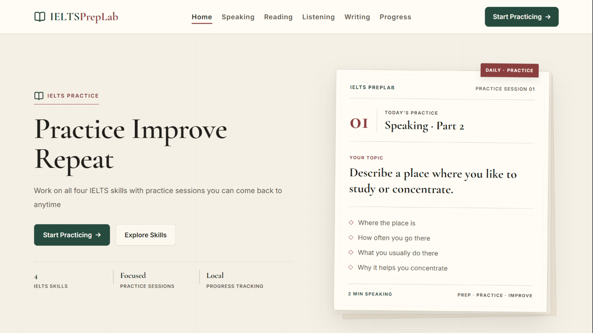
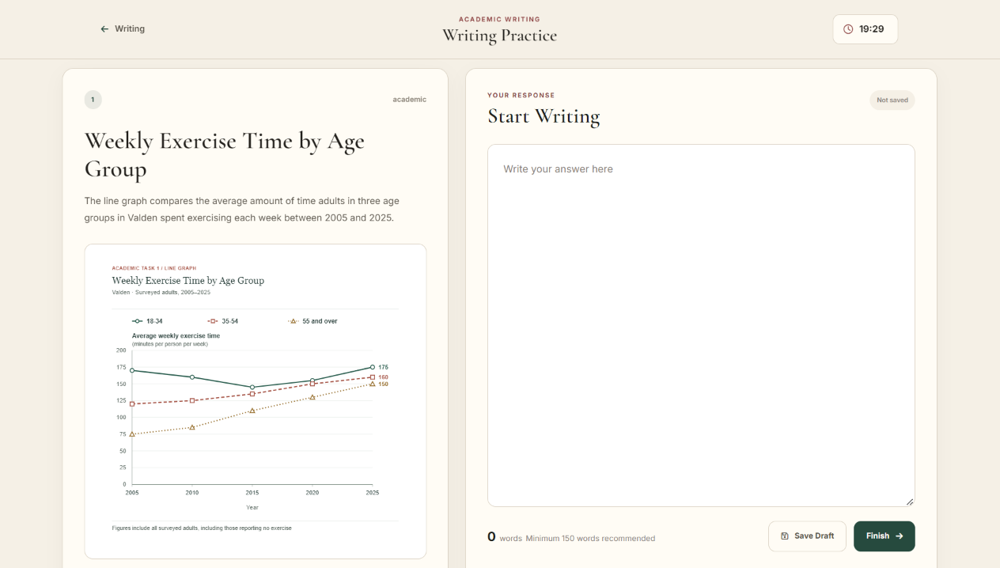
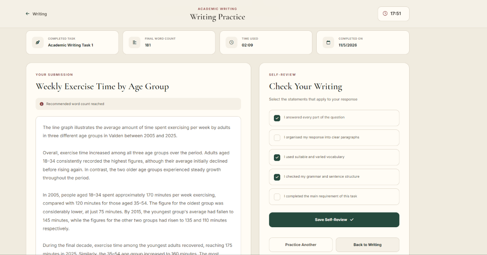
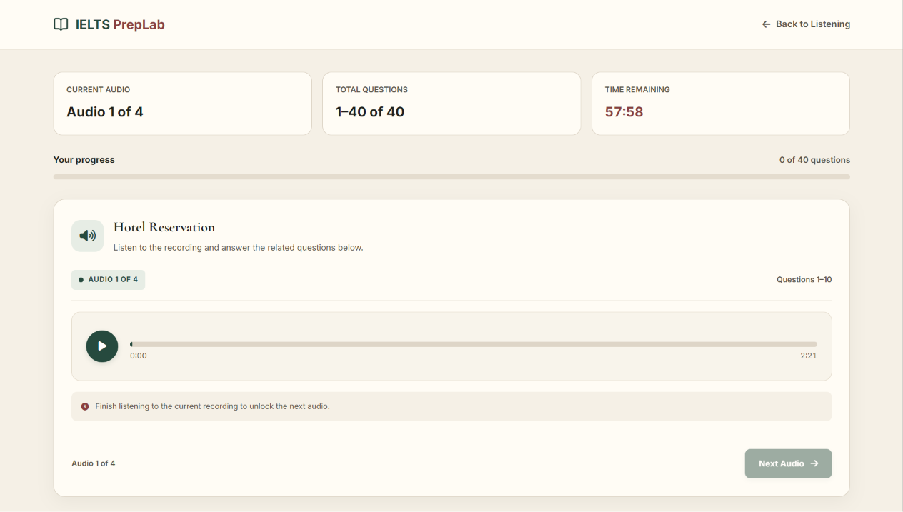
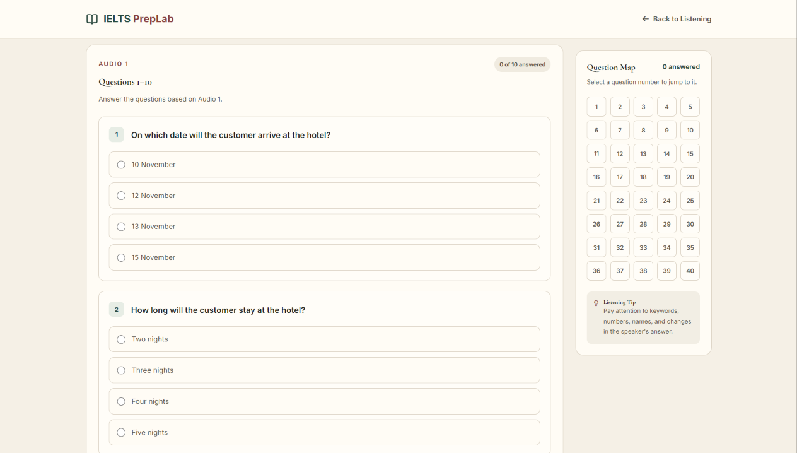
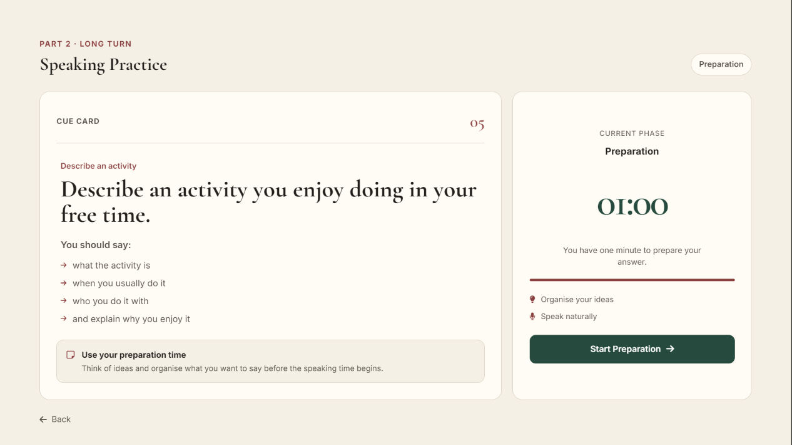
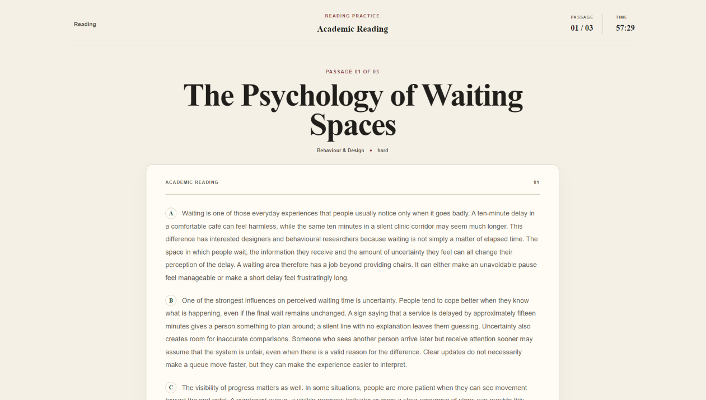
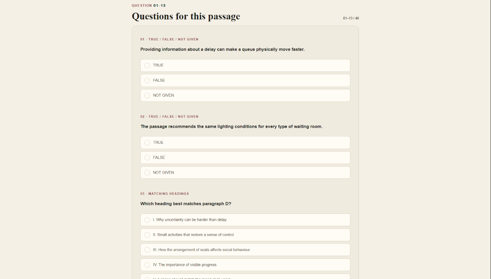
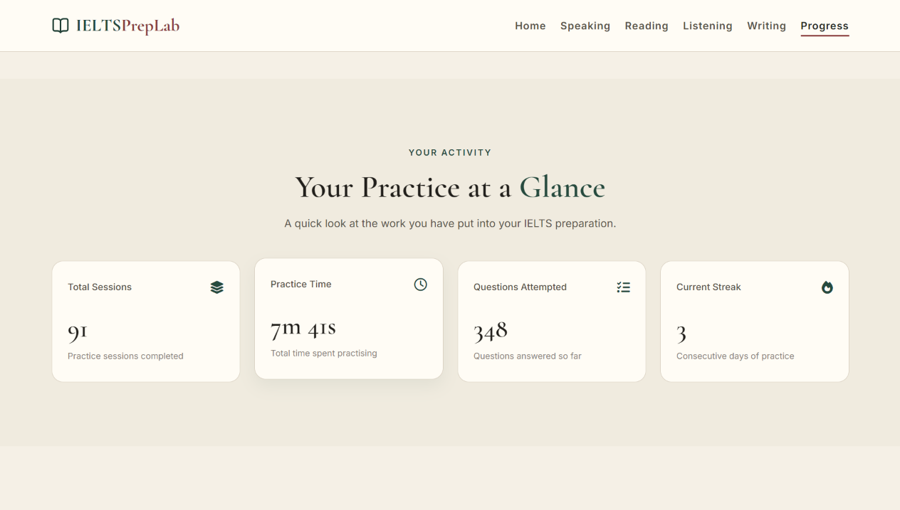
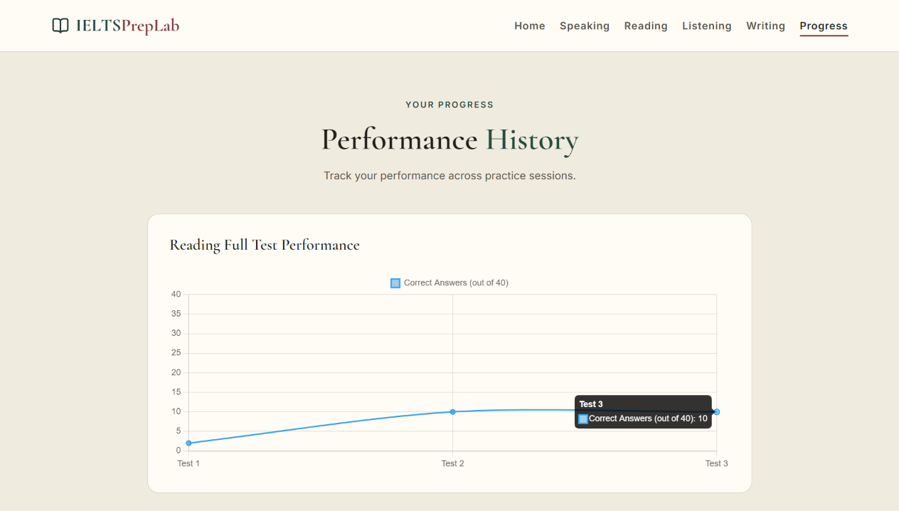

# IELTS PrepLab

A small project I built to bring IELTS practice into one place.

IELTS PrepLab is a browser-based practice platform where users can practise different IELTS skills, save their practice activity, and keep track of their progress. I built it using HTML, CSS, and vanilla JavaScript, without using a frontend framework or backend.

## Preview

### Homepage

### Writing

### Listening

### Speaking

### Reading

### Progress

## What it includes

- **Reading:** Quick and full practice sessions with passages and different question types.
- **Listening:** Quick practice sessions and full listening tests with audio and different question types.
- **Writing:** Academic Task 1 and Task 2 practice with a timer, word counter, saved drafts, and self-review.
- **Speaking:** Practice questions for all three parts of the IELTS Speaking test.
- **Progress:** Track practice sessions, time spent, recent activity, current streak, and progress through charts.

Writing drafts and practice history are saved in the browser using Local Storage, so there is no need to create an account.

## Built With

- HTML5
- CSS3
- JavaScript (Vanilla JS)
- Chart.js
- Browser Local Storage

## Run Locally

Clone the repository:

`git clone https://github.com/vineshkumar553/IELTS-PrepLab.git`

Open the project folder in VS Code and run `index.html` using the Live Server extension.

## A Note About the Project

This is a frontend-only project I built to practise my web development skills while creating something useful for IELTS preparation.

There is no backend or user authentication. Practice data and saved drafts stay in the user's browser through Local Storage.

## Live Project

[IELTS PrepLab](https://vineshkumar553.github.io/IELTS-PrepLab/)

---

Made by Vinesh Kumar

